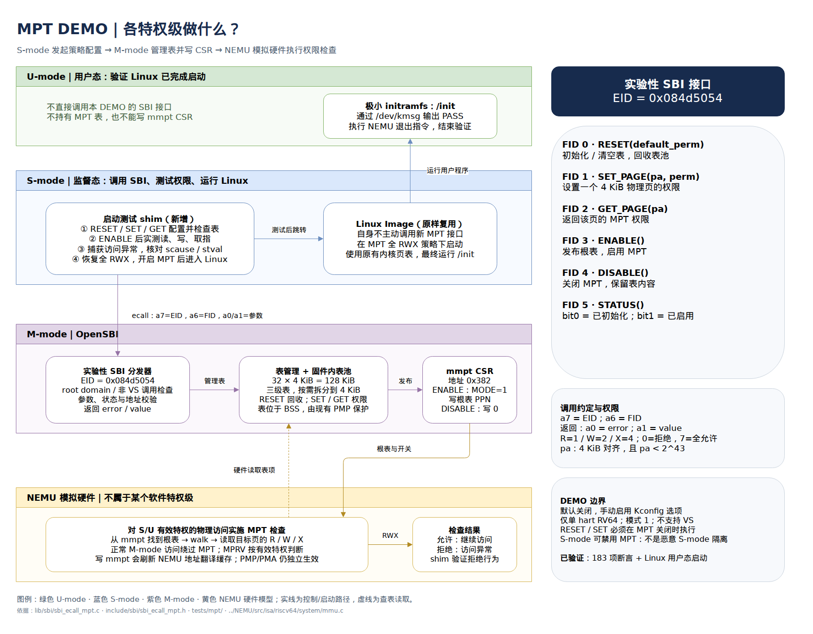

# Experimental NEMU MPT demo

The Linux shim and runner below are historical sources. Their earlier success
claims have no accompanying raw logs in this repository and are not treated as
verified results. The maintained single-hart standalone demo is in the parent
`smmpt-demo` repository (`payload/`, `scripts/`, and `docs/results/`).

## Privilege-level overview

[Editable draw.io diagram](diagrams/mpt-privilege.drawio)



This is a private experiment matching `../NEMU`, **not** a ratified Smmpt/SBI
implementation. It is off by default. Enable `CONFIG_SBI_ECALL_MPT_DEMO=y`
in the OpenSBI platform configuration and `CONFIG_RV_MPT_CHECK=y` in NEMU.
The extension is registered only for RV64, exactly one hart, and an accessible,
initially zero `mmpt` CSR. Merely booting the firmware does not enable MPT.
Do not enable this option on hardware with a different use of CSR 0x382.

## ABI

The public constants are in `include/sbi/sbi_ecall_mpt.h`.
Call from S-mode using the normal SBI v0.2 convention: `a7=0x084d5054`,
`a6=function`, arguments in `a0/a1`, result error in `a0`, value in `a1`.
The SBI base probe-extension function can discover this experimental EID.
Only the root domain, not VS-mode, may use the interface.

| Function | ID | Arguments | Result value |
| --- | --- | --- | --- |
| RESET | 0 | a0: default permissions (0..7) | 0 |
| SET_PAGE | 1 | a0: aligned physical page, a1: permissions | 0 |
| GET_PAGE | 2 | a0: aligned physical page | permissions |
| ENABLE | 3 | none | 0 |
| DISABLE | 4 | none | 0 |
| STATUS | 5 | none | bit 0: initialized, bit 1: enabled |

Permissions are R=1, W=2, X=4; zero denies all access. Addresses must be
4 KiB aligned and below 2^43. SET_PAGE additionally requires that the page
is readable by S-mode under the root domain's existing memory policy.
GET_PAGE reports MPT permissions, not the intersection with PMP/PMA.
RESET/SET_PAGE are rejected while enabled. SET_PAGE/GET_PAGE/ENABLE require
RESET first. Unknown functions return NOT_SUPPORTED, malformed arguments
INVALID_PARAM, uninitialized use INVALID_STATE, forbidden operations DENIED,
and pool exhaustion FAILED without altering existing permissions.
ENABLE and DISABLE are idempotent. RESET discards the old tree and reclaims
all table pages; restoring a single page to its default permission does not
coalesce tables or free pages.

## Implementation and limitations

* `mmpt` is CSR 0x382; mode 1 occupies bits 63:60 and root PPN bits 43:0.
  SDID is zero. Mode 2 is deliberately not implemented.
* Three levels use PA bits [42:34], [33:25], [24:16]. A leaf has V/L=1
  and sixteen 3-bit permission groups starting at bit 10. The selected group
  uses PA bits [33:30], [24:21], or [15:12], respectively.
* A 128 KiB, 4 KiB-aligned firmware BSS pool holds 32 tables including the root.
  RESET installs large uniform leaves. SET_PAGE splits only the path needed
  for a 4 KiB page, preserving every neighboring permission. No S-mode table
  pointers or dynamically supplied physical table addresses are accepted.
* NEMU flushes its translation cache on writes to `mmpt`; a memory fence
  precedes CSR publication. Updates are allowed only when MPT is disabled.
  No generic hart, trap, domain, or Linux code is changed.
* This is **not isolation from a malicious S-mode supervisor**: S-mode can
  disable MPT. Firmware protection still depends on OpenSBI's existing PMP
  policy. There is no multi-hart shootdown, per-domain policy, hotplug,
  suspend/resume support, or production resource management.
* Restricting the caller's code, stack, page tables, or console memory can
  fault immediately on return from ENABLE. For a Linux boot smoke test use
  RESET(7), ENABLE, and no denied pages. Keep firmware protection enabled.

## Historical Linux runner (not the standalone demo)

Run from the OpenSBI repository (these commands compile and execute the demo):

```sh
bash tests/mpt/run.sh enabled
bash tests/mpt/run.sh disabled
bash tests/mpt/run.sh no-csr
```

Prerequisites: the NEMU host build dependencies, Python 3, rsync, dtc, and an
RV64 cross toolchain. The default tool prefix is
`riscv64-unknown-linux-gnu-`; override with `CROSS_COMPILE`. Other overrides:
`NEMU_SRC`, `LINUX_IMAGE`, `JOBS` (default 8), `TIMEOUT` (seconds, default 120).
Paths to binary images must not contain whitespace.

The script copies NEMU into `build/mpt-demo/nemu-{mpt,no-mpt}`, excluding its
Git metadata and main build directory. It never reconfigures or builds in the
original NEMU checkout, and disables NEMU's automatic git-commit recipe.
It derives configurations from `riscv64-xs_mpt_defconfig`, disables PERF_OPT,
and enables actual PMP/PMA checks. NEMU uses a 4 GiB sparse mmap allocation
(to retain its 64-bit physical address type); the DT advertises 2 GiB RAM.
OpenSBI is built with `CONFIG_SBI_ECALL_MPT_DEMO=y` as an explicit make override
(`n` for the disabled regression); the generic platform defaults stay unchanged.
Do not run enabled and disabled builds concurrently: they share the MPT NEMU copy.

The unmodified payload is `../linux-riscv-gate/arch/riscv/boot/Image`.
The S-mode shim exercises the ABI, enables a permissive MPT, then passes the
original hart ID and DTB to Linux. A generated 64 KiB initramfs contains a
minimal `/init` that writes a success marker through `/dev/kmsg` and exits the
simulation with NEMU's custom trap instruction. It is a boot test, not a shell
or a production root filesystem. No Linux source or Image changes are required.

Memory layout:

| Address | Contents |
| --- | --- |
| 0x80000000 | OpenSBI, including protected MPT pool |
| 0x80200000 | S-mode test shim, private stack and scratch pages |
| 0x80400000 | Existing Linux Image |
| 0x84000000 | Minimal initramfs |
| 0x88000000 | Relocated DTB |

The linker rejects an oversized Image overlapping the initramfs. The supplied
Linux Image's PTP/IEE configuration requires Sv39 (`no4lvl` in the DT bootargs)
and a large early page-table pool; a 256 MiB DT does not suffice. The DT avoids
IRQ-driven UART TX because NEMU's PLIC implementation is only a stub.

## Evidence status

No raw Linux-run logs are archived here. The former three-mode success table
and serial excerpt have been removed rather than presented as verified output.
The historical script still builds and runs a Linux shim, requires an external
Linux Image, and does not provide the parent repository's dependency locks or
source/artifact checks. Its NEMU invocations now use `git_commit=` to suppress
automatic commits.

The parent repository archives a previous standalone enabled run with 183
assertions at NEMU revision `16f993840b97afb491a12fc43ce50eb58f49e101` and OpenSBI
revision `6ed11de7a7b829acd63716b39b737f61794f0c03`. That evidence does not establish
Linux boot, disabled/no-csr results, or success of later payload changes.
